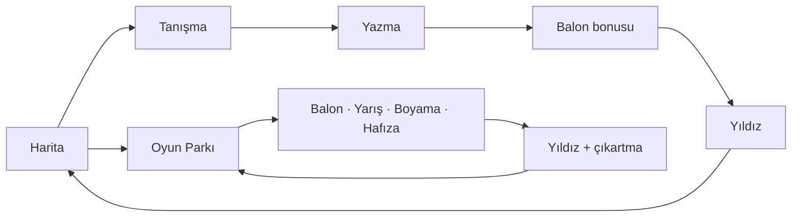

<div align="center">

# Harf Macerası

**Okumaya yeni başlayan çocuklar için oyunlu ve eğitici harf öğrenme platformu.**


[**Canlı demo**](https://harf-macerasi.vercel.app) · [Özellikler](#özellikler) · [Mimari](#mimari-ve-tasarım-kararları) · [Geliştirme](#geliştirme)


</div>

## Neden bu proje?

Harf öğrenirken bir çocuğun henüz görmediği harfle karşılaşması kafa karıştırır. Harf Macerası, öğretim sırasına sadık kalır: çocuk hangi harfleri öğrendiyse **yalnızca onlardan oluşan** heceleri ve kelimeleri görür. `a` ve `n` öğrenilince `an` ve `na` gelir, `e` eklenince `en` ve `ne`. Müfredat, kod yerine **veri** olarak tutulur; harf sırası, kelime havuzu ve yazım yolları tek yerden değişir.

Harfler, Türkiye'deki ilkokuma programının öğretim sırasındaki beş gruba göre ilerler. Proje resmî bir ürün değildir ve MEB ile bağlantılı değildir.

## Özellikler

- **29 harf, 5 grup:** Her harf için aynı döngü: sesli tanışma, hece ve kelime okuma, kesik çizgili yazma, balon bonusu, yıldız ödülü.
- **Otomatik içerik:** Heceler ve kelimeler, öğrenilen harflerden kendiliğinden üretilir. Çocuk görmediği harfle karşılaşmaz.
- **Kesik çizgili yazma:** Parmakla ya da fareyle harfin üzerinden geçilir. Doğru sıra ve yön takip edilir, hata cezalandırılmaz.
- **29 animasyonlu karakter:** Altısı elle çizilmiş, 23'ü bir "karakter fabrikası"yla (renk, kulak biçimi, aksesuar) üretilmiş. Her harfin kendi karakteri var; konuşur, sevinir, göz kırpar.
- **Oyun Parkı:** Balon Patlat, Yol Yarışı, Boyama Bulmacası (harf, hece ya da kelimeyle eşleştirmeli) ve Hafıza Kartları.
- **Ödül sistemi:** Yıldızlar, 24 çıkartma ve çıkartma albümü.
- **Hesapsız ve takipsiz:** İlerleme yalnızca cihazda saklanır. Reklam ve istatistik aracı yok.
- **PWA:** Ana ekrana eklenir, internetsiz çalışır.
- **Erişilebilirlik:** Klavyeyle kullanım, ekran okuyucu etiketleri, `prefers-reduced-motion` desteği, büyük dokunma hedefleri.
- **Mikrofonla okuma (deneysel, varsayılan kapalı):** Çocuğun söylediğini Web Speech API ile kontrol eder; hata durumunda hiçbir zaman "yanlış" demez.

## Ekran görüntüleri

|              Macera haritası              |              Tanışma ve okuma               |           Kesik çizgili yazma           |
| :---------------------------------------: | :-----------------------------------------: | :-------------------------------------: |
|  |  |  |
|              **Oyun Parkı**               |              **Balon Patlat**               |             **Yol Yarışı**              |
|      |      |  |
|           **Boyama Bulmacası**            |             **Hafıza Kartları**             |           **Çıkartma Albümü**           |
|  |    |  |

<details>
<summary>Daha fazlası: mobil görünüm, ebeveyn sayfası, karakterler</summary>

|                     Mobil: harita                     |                    Mobil: yazma                     |
| :---------------------------------------------------: | :-------------------------------------------------: |
|  |  |


</details>

## Nasıl çalışır?



| Grup | Harfler     | Harita bölgesi   |
| ---- | ----------- | ---------------- |
| 1    | A N E T İ L | Papatya Bahçesi  |
| 2    | O K U R I M | Mantar Ormanı    |
| 3    | Ü S Ö Y D Z | Gökkuşağı Tepesi |
| 4    | Ç B G C Ş   | Kale Yolu        |
| 5    | P H V Ğ F J | Bulut Ülkesi     |

Bir sonraki harf, öncekini tamamlayınca açılır. Üç harf bitince Oyun Parkı açılır ve oyunlar yalnızca öğrenilmiş harflerle kurulur.

## Mimari ve tasarım kararları

```text
src/
├── components/     Button, Scene, Confetti ve SVG karakterler
├── data/           alphabet, words, strokes, cast, stickers (müfredat verisi)
├── features/
│   ├── curriculum/ hece ve kelime üretimi, Türkçe heceleme
│   ├── trace/      kesik çizgili yazma: algoritma ve ekran
│   ├── games/      balon, yarış, boyama, hafıza
│   ├── speech/     konuşma eşleştirme
│   └── ...         harita, park, albüm, sonuç, ebeveyn sayfası
├── lib/            speech, listen, progress, settings
└── types/
```

- **Veri odaklı müfredat.** Harfler, kelimeler, yazım yolları ve karakter dağılımı TypeScript verisi olarak durur, derleyici denetler. Testler veriyi de denetler: her harfin yazım yolu ve karakteri var mı, her kelimedeki harf alfabede tanımlı mı, her hecede tam bir ünlü var mı.
- **Saf fonksiyonlar.** Hece üretimi, kelime süzme, oyun soruları, yarış kuralları, hafıza durum makinesi, ilerleme okuma ve yazma tamamen saf; rastgelelik dışarıdan verildiği için testleri deterministik.
- **Yazma algoritması.** Her harf SVG yollarından oluşur. Yol, düzenli aralıklı noktalara bölünür; parmağın konumu yalnızca bir sonraki birkaç noktaya yakınsa ilerleme sayılır. Böylece yanlış yönde ya da kestirmeden çizim ilerletmez, yavaş giden de takılmaz. Tolerans tek bir sabittir.
- **Türkçeye özgü ayrıntılar.** `i`/`İ` ve `ı`/`I` büyük-küçük harf eşlemesi elle yazılır (`toUpperCase()` Türkçede yanlış sonuç verir), metin normalleştirme `tr-TR` kuralıyla yapılır, `ğ` hiçbir hecenin başında durmadığı için yalnızca ünlüden sonra çalışılır.
- **Tek ses noktası.** Tüm konuşmalar `speak()` üzerinden geçer. Önce `public/audio` altındaki ses kaydına bakar, yoksa cihazın Türkçe sesine döner. Gerçek ses kayıtlarına geçiş koda dokunmadan yapılabilir. `AbortSignal` sayesinde ekran değişince konuşma ve bekleme hemen kesilir.
- **Dayanıklı ilerleme kaydı.** Saklanan veri okunurken doğrulanır: bozuk, eski ya da yabancı veri uygulamayı çökertmez, geçersiz kayıtlar ayıklanır.
- **Karakter fabrikası.** 23 karakter, renk, kulak biçimi ve aksesuarın birleşimiyle üretilir; bir test hiçbir birleşimin tekrar etmediğini denetler.

**Teknolojiler:** React, TypeScript, Vite, Vitest, ESLint, Prettier, vite-plugin-pwa, Web Speech API, GitHub Actions, Vercel.

## Geliştirme

```bash
npm install
npm run dev
```

| Komut                 | Açıklama                                               |
| --------------------- | ------------------------------------------------------ |
| `npm run dev`         | Geliştirme sunucusu                                    |
| `npm run build`       | Yayın paketi (PWA dosyalarıyla birlikte)               |
| `npm run preview`     | Üretim paketini yerelde çalıştırır                     |
| `npm test`            | Birim testleri (Vitest)                                |
| `npm run lint`        | ESLint                                                 |
| `npm run format`      | Prettier ile biçimlendirir                             |
| `npm run icons`       | Uygulama simgelerini üretir                            |
| `npm run screenshots` | README görsellerini üretir (`npm run dev` açık olmalı) |

Geliştirme sırasında `/?gallery` adresi, 29 harfin yazım yolunu ve tüm karakterleri tek ekranda gösterir.

Her gönderimde GitHub Actions şu kontrolleri çalıştırır: lint, biçim, test, derleme.

## Gizlilik

Hesap, ad, e-posta ya da yaş bilgisi istenmez. İlerleme ve ayarlar yalnızca cihazın tarayıcısında saklanır. Reklam, takip ve istatistik aracı yoktur. Mikrofonla okuma varsayılan olarak kapalıdır; açılırsa ses, tarayıcının konuşma tanıma hizmeti tarafından işlenir ve tarayıcıya göre bir sunucuya gönderilebilir. Uygulama sesi kaydetmez.

## Bilinen sınırlar

- Okunuşlar cihazın Türkçe sesiyle yapılır, yetişkin sesidir ve kalitesi cihaza göre değişir.
- Mikrofonla okuma deneyseldir. Tarayıcı konuşma tanıma, çocuk sesinde ve tek harf ya da kısa hecelerde zayıftır.
- Kelime listesi ve okunuşlar henüz bir öğretmen tarafından gözden geçirilmedi.
- Yazma toleransı gerçek çocuklarla denenmedi.

## Yol haritası

- [x] 29 harflik tam müfredat sırası
- [x] Kesik çizgili yazma, oyunlar, ödül sistemi
- [x] PWA, çevrimdışı çalışma
- [ ] Gerçek ses kaydı (çocuk sesi)
- [ ] Ebeveyn paneli (hangi harfte zorlanıldı)
- [ ] Zorlanılan harfler için uyarlanabilir tekrar
- [ ] Büyük harf yazımı
- [ ] Profesyonel illüstrasyonlu karakterler
- [ ] Öğretmen incelemesi ve kelime havuzunun genişletilmesi

## Kaynaklar

Yazı tipi: [Fredoka](https://fonts.google.com/specimen/Fredoka) (SIL Open Font License), `@fontsource` üzerinden. Karakterler, sahne ve simgeler bu projede kodla çizilmiştir. Çıkartmalar cihazın emoji yazı tipiyle gösterilir.

## Lisans

[MIT](LICENSE)
