<div align="center">

🇬🇧 **English** · 🇹🇷 [Türkçe](README.tr.md)

# Harf Macerası (Letter Adventure)

**A gamified, curriculum-ordered letter-learning app for children who are starting to read.**


[**Live demo**](https://harf-macerasi.vercel.app) · [Features](#features) · [Architecture](#architecture-and-design-decisions) · [Development](#development)

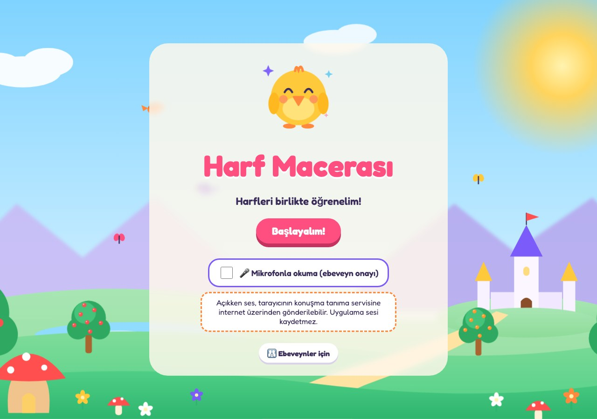

</div>

## Why this project?

Harf Macerası teaches the **Turkish alphabet** to early readers. The app, its voice and its content are in Turkish by design; this README is in English so that developers can read the code and the decisions behind it.

When a child is learning letters, meeting a letter they have not learned yet is confusing. This app sticks to the teaching order: a child only sees syllables and words made **exclusively from the letters they have already learned**. After `a` and `n`, the syllables `an` and `na` appear; adding `e` brings `en` and `ne`. The curriculum is kept as **data, not code**: the letter order, the word pool and the stroke paths all live in one place.

Letters follow the five groups of the Turkish primary-school literacy programme. This is an independent project and is not affiliated with the Turkish Ministry of National Education.

## Features

- **29 letters in 5 groups.** One loop for every letter: spoken introduction, syllable and word reading, dotted-line tracing, a balloon bonus game, and a star reward.
- **Generated content.** Syllables and words are derived automatically from the letters learned so far.
- **Dotted-line tracing.** Trace the letter with a finger or mouse. The order and direction of strokes are followed, and mistakes are never punished.
- **29 animated characters.** Six are hand-drawn SVGs and 23 come from a "character factory" (colour, ear shape, accessory). Every letter has its own character that talks, celebrates and blinks.
- **Game Park.** Balloon Pop, Road Race, a Paint Puzzle (matching letters, syllables or words) and Memory Cards.
- **Rewards.** Stars, 24 stickers and a sticker album.
- **No accounts, no tracking.** Progress is stored only on the device. No ads, no analytics.
- **PWA.** Installable to the home screen, works offline.
- **Accessibility.** Keyboard support, screen reader labels, `prefers-reduced-motion` support and large touch targets.
- **Reading with the microphone (experimental, off by default).** Checks what the child says via the Web Speech API and never tells them they are "wrong".

## Screenshots

|                Adventure map                |             Introduction and reading             |            Dotted-line tracing            |
| :-----------------------------------------: | :----------------------------------------------: | :---------------------------------------: |
|   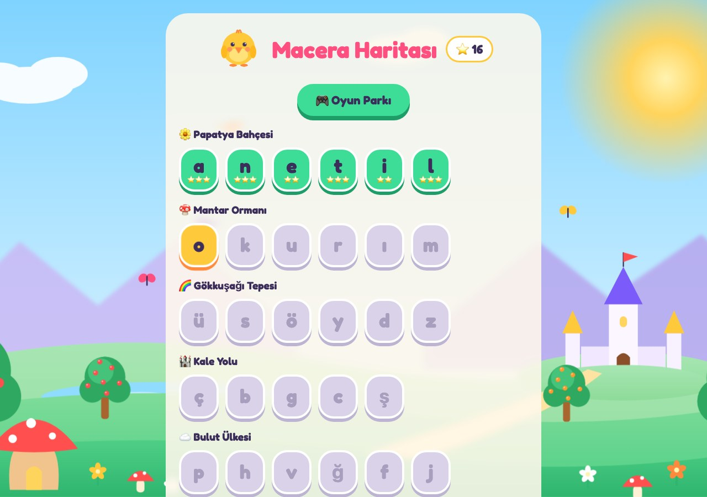    | 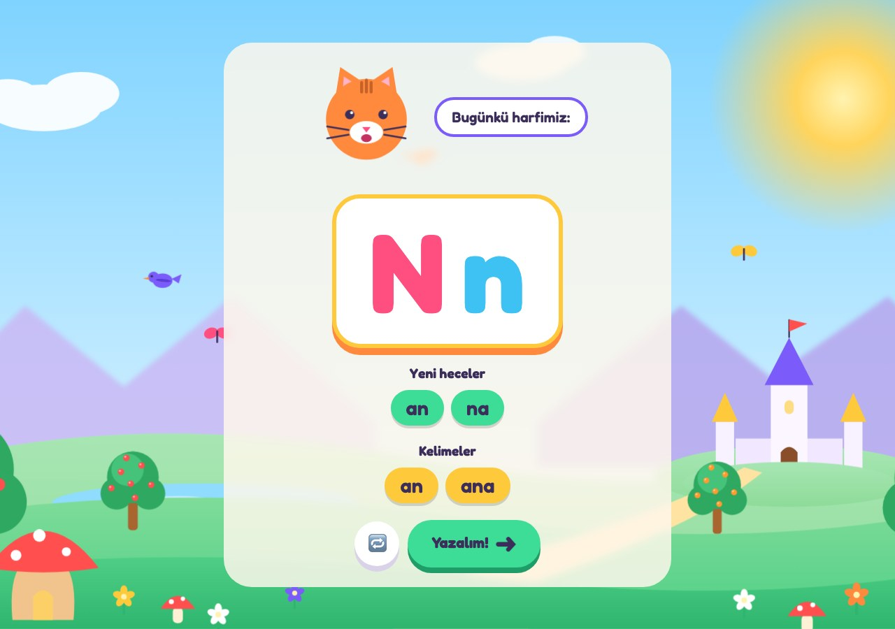 | 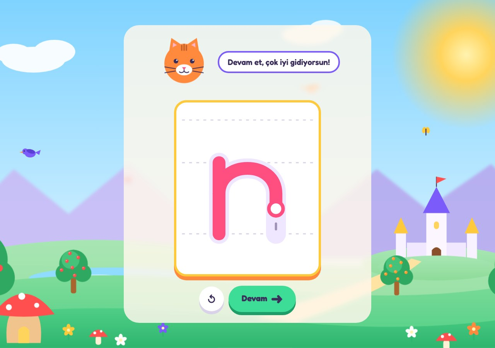 |
|                **Game Park**                |                 **Balloon Pop**                  |               **Road Race**               |
|    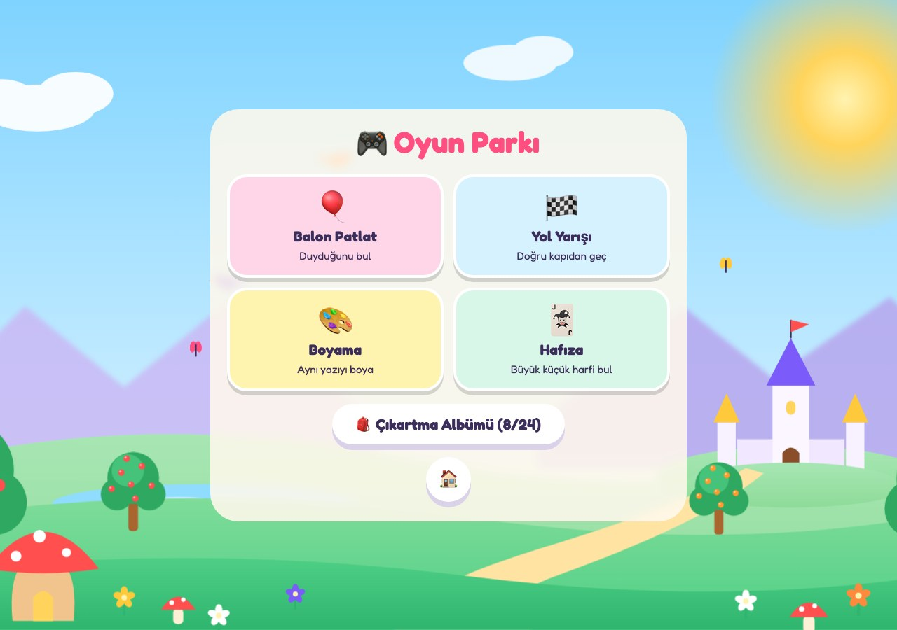    |    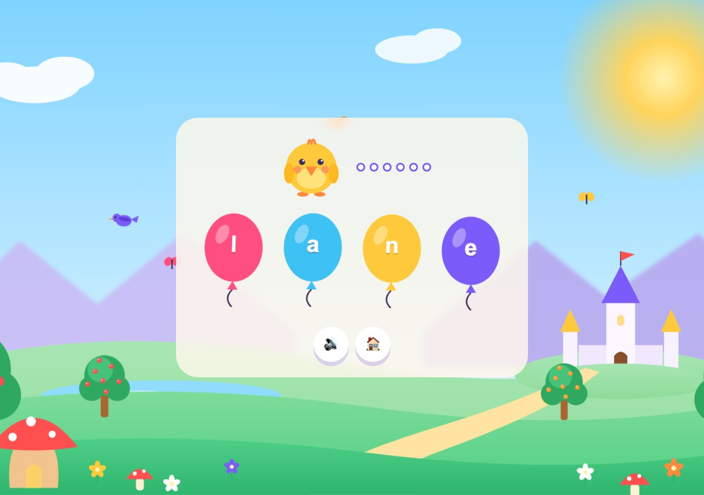    |  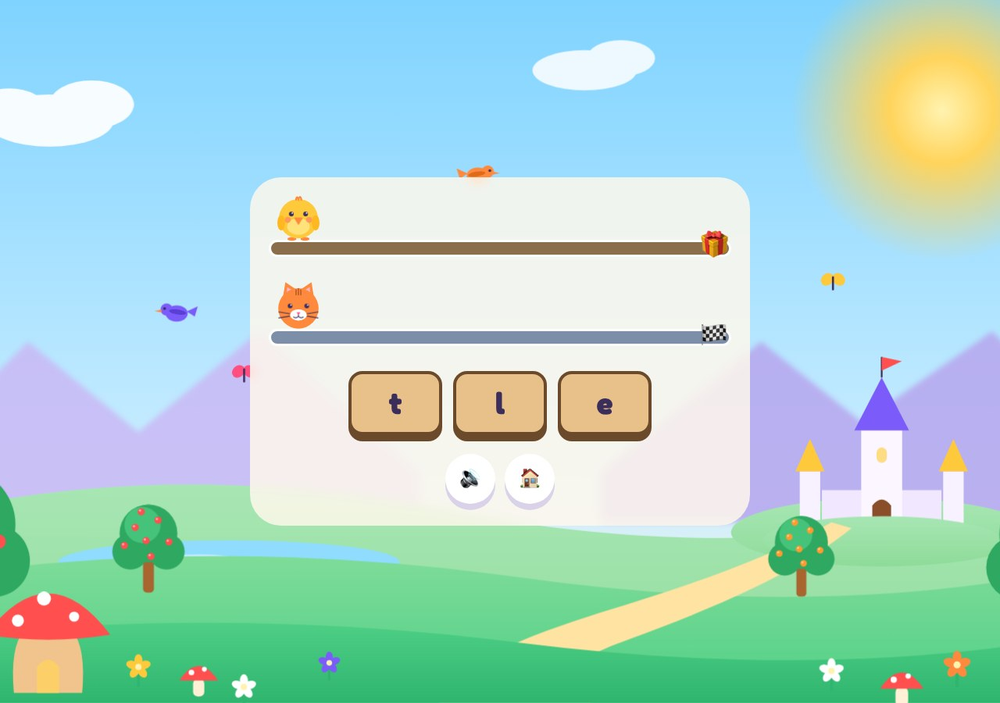   |
|              **Paint Puzzle**               |                 **Memory Cards**                 |             **Sticker Album**             |
| 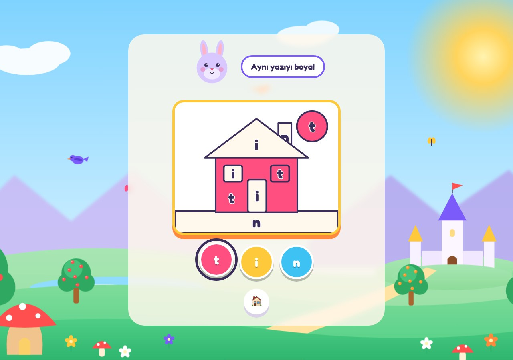 |    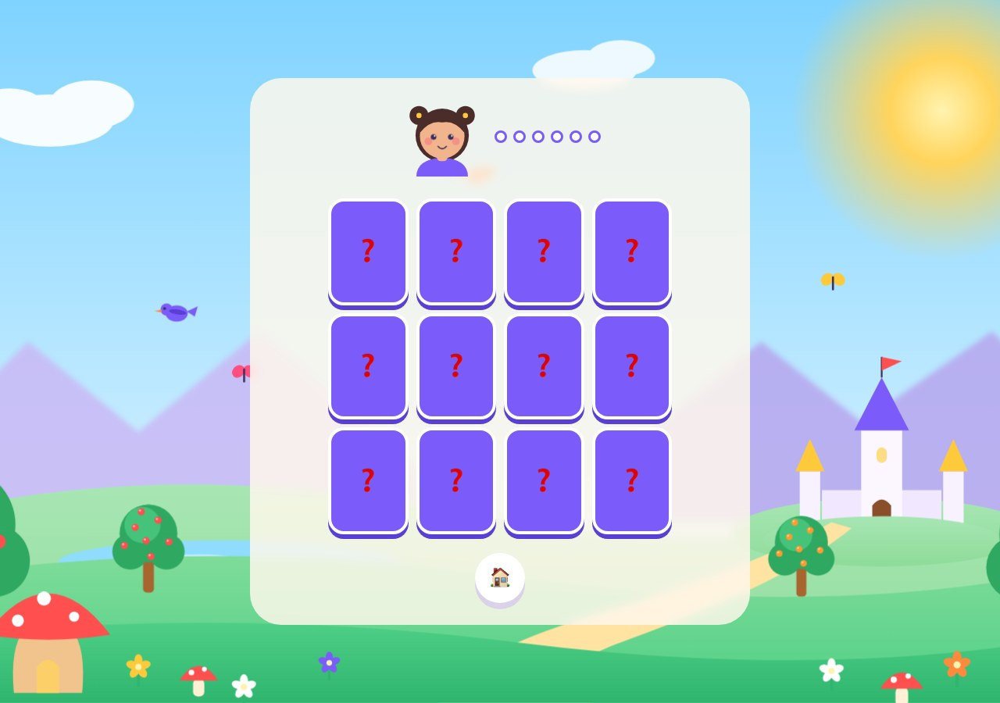     |  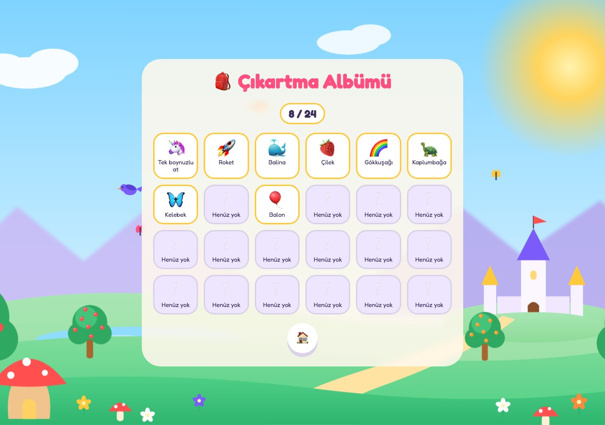  |

<details>
<summary>More: mobile view, parent page, characters</summary>

|                     Mobile: map                     |                    Mobile: tracing                     |
| :-------------------------------------------------: | :----------------------------------------------------: |
| 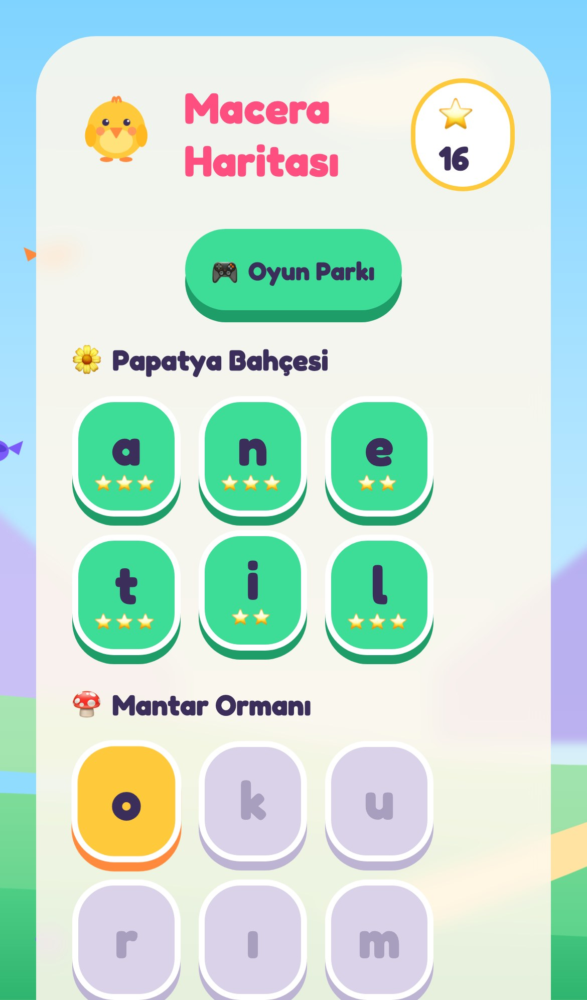 | 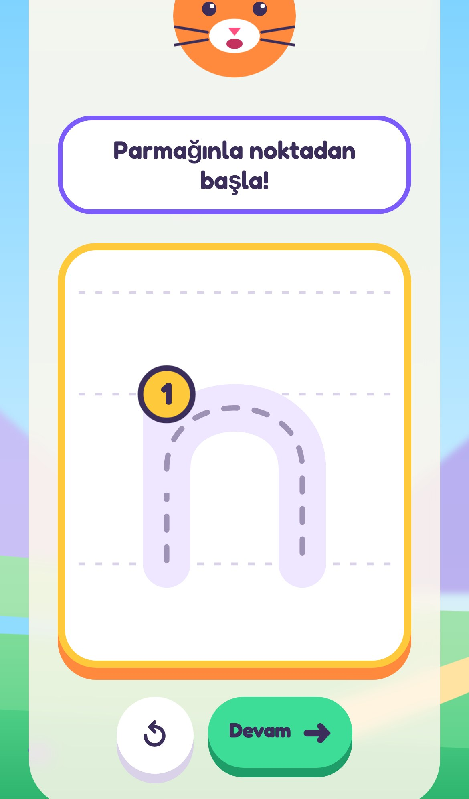 |

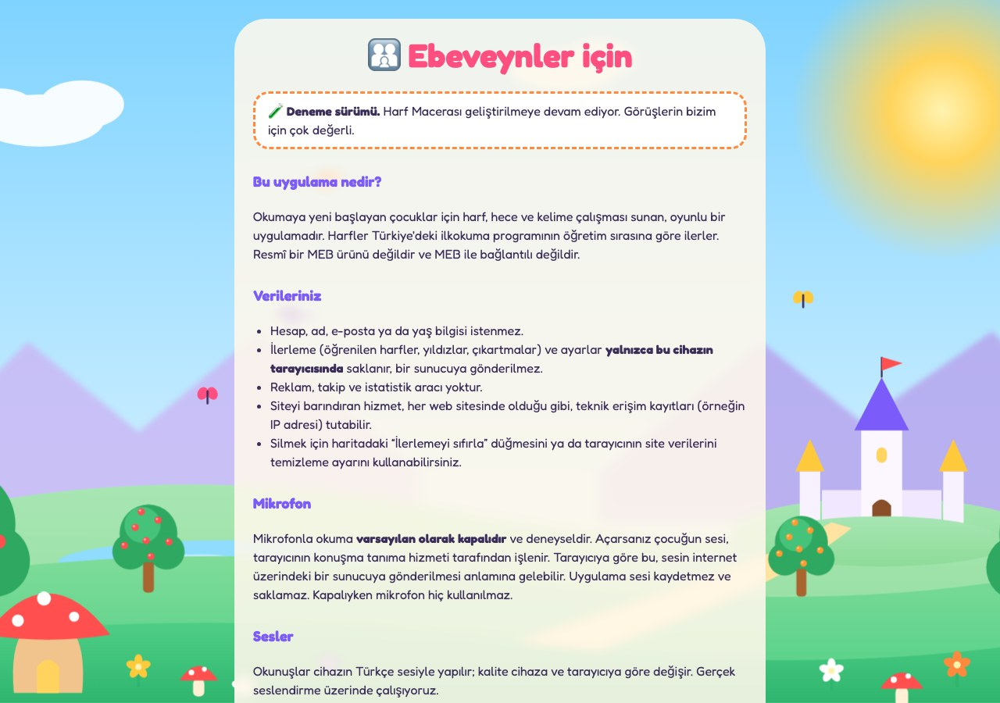

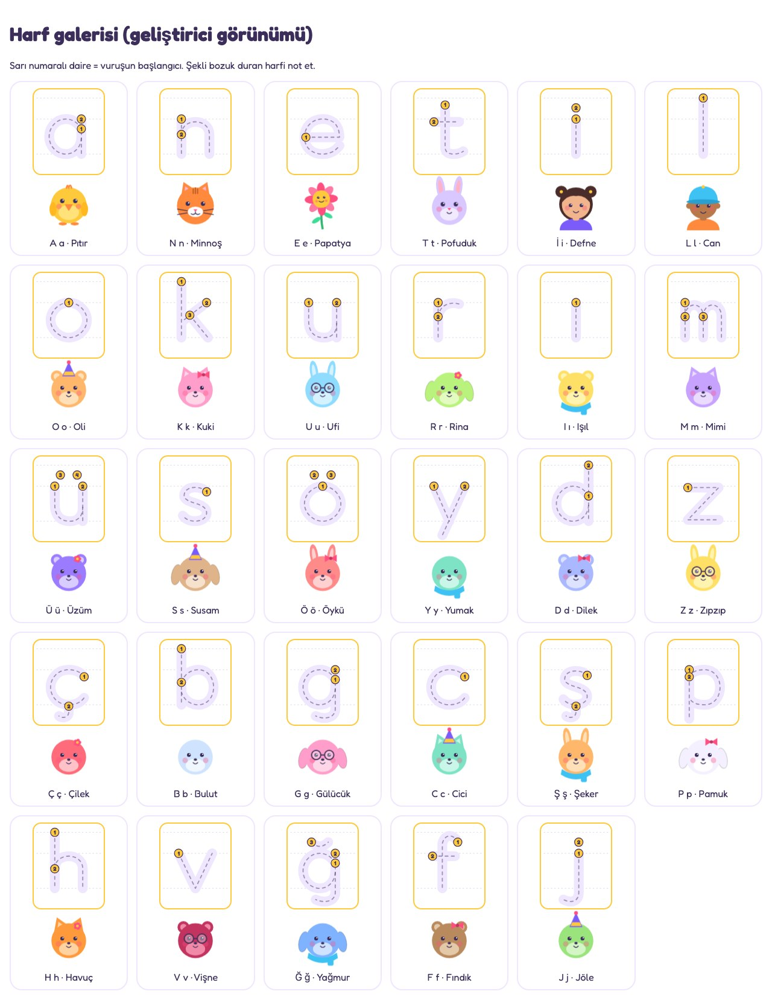

</details>

## How it works

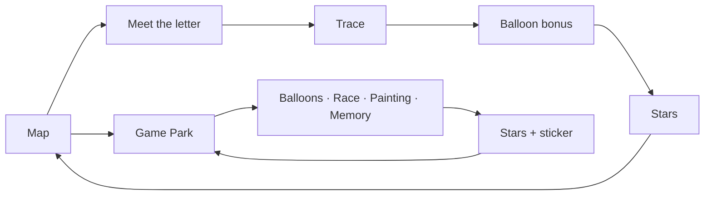

| Group | Letters     | Map region (in the app)         |
| ----- | ----------- | ------------------------------- |
| 1     | A N E T İ L | Papatya Bahçesi (Daisy Garden)  |
| 2     | O K U R I M | Mantar Ormanı (Mushroom Forest) |
| 3     | Ü S Ö Y D Z | Gökkuşağı Tepesi (Rainbow Hill) |
| 4     | Ç B G C Ş   | Kale Yolu (Castle Road)         |
| 5     | P H V Ğ F J | Bulut Ülkesi (Cloud Land)       |

The next letter unlocks when the previous one is completed. After three letters the Game Park opens, and its games are built only from letters the child has learned.

## Architecture and design decisions

```text
src/
├── components/     Button, Scene, Confetti and SVG characters
├── data/           alphabet, words, strokes, cast, stickers (curriculum data)
├── features/
│   ├── curriculum/ syllable and word generation, Turkish syllabification
│   ├── trace/      dotted-line tracing: algorithm and screen
│   ├── games/      balloons, race, painting, memory
│   ├── speech/     speech matching
│   └── ...         map, park, album, results, parent page
├── lib/            speech, listen, progress, settings
└── types/
```

- **Data-driven curriculum.** Letters, words, stroke paths and the character cast are typed TypeScript data checked by the compiler. Tests check the data too: every letter has stroke paths and a character, every character in the word pool exists in the alphabet, and every syllable has exactly one vowel.
- **Pure functions.** Syllable generation, word filtering, game rounds, race rules, the memory-game state machine and progress parsing are pure. Randomness is injected, so tests are deterministic.
- **Tracing algorithm.** Each letter is built from SVG paths. A path is sampled into evenly spaced points, and the pointer only advances progress when it is near one of the next few points. Drawing in the wrong direction or cutting corners does not count, while slow drawing is never stuck. Tolerance is a single constant.
- **Turkish-specific details.** Upper-casing for `i`/`İ` and `ı`/`I` is written by hand (`toUpperCase()` is wrong for Turkish), text normalisation uses `tr-TR` rules, and `ğ`, which never starts a syllable, is only practised after a vowel.
- **A single speech entry point.** Every utterance goes through `speak()`. It first looks for a recorded clip under `public/audio` and falls back to the device's Turkish voice, so real recordings can be added without touching the code. An `AbortSignal` cancels speech and waits immediately when the screen changes.
- **Robust progress storage.** Stored data is validated on read: corrupted, old or foreign data cannot crash the app, and invalid entries are dropped.
- **Character factory.** 23 characters are produced from combinations of colour, ear shape and accessory, and a test makes sure no combination repeats.

**Tech:** React, TypeScript, Vite, Vitest, ESLint, Prettier, vite-plugin-pwa, Web Speech API, GitHub Actions, Vercel.

## Development

```bash
npm install
npm run dev
```

| Command               | Description                                       |
| --------------------- | ------------------------------------------------- |
| `npm run dev`         | Development server                                |
| `npm run build`       | Production build (including PWA files)            |
| `npm run preview`     | Serve the production build locally                |
| `npm test`            | Unit tests (Vitest)                               |
| `npm run lint`        | ESLint                                            |
| `npm run format`      | Format with Prettier                              |
| `npm run icons`       | Generate app icons                                |
| `npm run screenshots` | Generate README images (`npm run dev` must be on) |

During development, `/?gallery` shows the stroke paths of all 29 letters and every character on one screen.

On every push, GitHub Actions runs lint, formatting, tests and the build.

## Privacy

No account, name, e-mail address or age is requested. Progress and settings are stored only in the device's browser. There are no ads, trackers or analytics. Reading with the microphone is **off by default**; when enabled, audio is processed by the browser's speech recognition service and, depending on the browser, may be sent to a server. The app itself does not record or store audio.

## Known limitations

- Pronunciations use the device's Turkish voice. It is an adult voice and its quality varies by device.
- Microphone reading is experimental. Browser speech recognition is weak with children's voices and with single letters or very short syllables.
- The word list and pronunciations have not yet been reviewed by a teacher.
- Tracing tolerance has not been tested with real children.

## Roadmap

- [x] Full 29-letter curriculum order
- [x] Dotted-line tracing, games and rewards
- [x] PWA with offline support
- [ ] Real voice recordings (a child's voice)
- [ ] Parent dashboard (which letters are difficult)
- [ ] Adaptive repetition for difficult letters
- [ ] Upper-case letter tracing
- [ ] Professionally illustrated characters
- [ ] Teacher review and a larger word pool

## Credits

Font: [Fredoka](https://fonts.google.com/specimen/Fredoka) (SIL Open Font License) via `@fontsource`. Characters, scenery and icons are drawn in code for this project. Stickers are rendered with the device's emoji font.

## License

[MIT](LICENSE)
